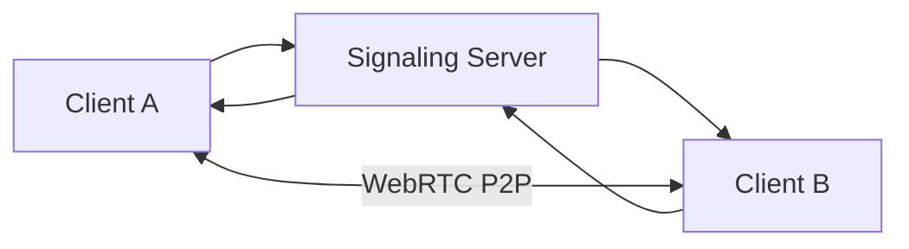

# 🎥 Video Confressing App


A real-time video conferencing app built with **React, Node.js, WebRTC and Socket.io**.

## 🚀 Demo


## ✨ Features
- [ ] Login SignUp Forgot Password
- [ ] HD Video Calls
- [ ] Screen Sharing
- [ ] Real-time Chat
- [ ] Room Create / Join
- [ ] Call Recording
- [ ] Noise Cancellation
- [ ] Real Time Filters
- [ ] Random chats 
- [ ] Chats on basis of interest
- [ ] Horizonatlly Scalling
- [ ] Aws deployment
- [ ] CICD pipeline
- [ ] OpenApi Specs


## 🛠 Tech Stack

| Frontend | Backend | Realtime |
|----------|:-------:|---------:|
| React    | Node.js | Socket.io |
| Tailwind | Express | WebRTC   |

## 📦 Getting Started

### Prerequisites

- Node.js `>=18`
- npm / yarn
- Modern browser with WebRTC support

### Installation

```bash
git clone https://github.com/sameer1sheikh2mansoori3/video-confressing-app.git
cd video-confressing-app
npm install
```

### Run Locally

```bash
npm run dev
```

Frontend: `http://localhost:3000`  
Backend: `http://localhost:5000`

## 🧩 Architecture



## 📁 Folder Structure

```text
video-confressing-app/
├── client/
├── server/
├── assets/
└── README.md
```

## 🤝 Contributing

1. Fork the repo
2. Create a branch: `git checkout -b feature/my-feature`
3. Commit changes: `git commit -m "Add my feature"`
4. Push: `git push origin feature/my-feature`
5. Open a Pull Request

## 📄 License

This project is licensed under the **MIT License**.

## 👨‍💻 Author

**Your Name**  
[GitHub](https://github.com/sameer1sheikh2mansoori3) 